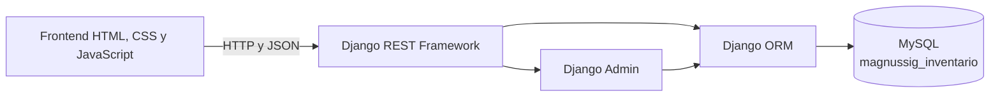

# MAGNUSSIG SIG — Sistema de Gestión de Inventario

**MAGNUSSIG S.A.S.**

Versión del producto: 1.0

Institución: Fundación Escuela Tecnológica de Neiva (FET)

Asignatura: Lenguaje de Programación 1 — 2026-2

Empresa: MAGNUSSIG S.A.S.

Ubicación: Neiva, Huila, Colombia

## 2. Información general

| Campo | Información |
|---|---|
| Producto académico | MAGNUSSIG SIG — Sistema de Gestión de Inventario |
| Empresa | MAGNUSSIG S.A.S. |
| Institución | Fundación Escuela Tecnológica de Neiva (FET) |
| Asignatura | Lenguaje de Programación 1 |
| Periodo académico | 2026-2 |
| Versión | 1.0 |
| Repositorio | [Proyecto_final_semestre3](https://github.com/salomonjesuschavarrocastaneda-dev/Proyecto_final_semestre3.git) |

## 3. Descripción del sistema

MAGNUSSIG SIG es una aplicación web académica para centralizar la gestión operativa del inventario de MAGNUSSIG S.A.S. El sistema integra la administración de productos, categorías, existencias, movimientos, ventas, usuarios, roles, reportes y solicitudes de ayuda mediante una arquitectura cliente-servidor.

La interfaz gráfica se desarrolla con tecnologías web del navegador. Las operaciones de negocio y la persistencia se realizan a través de una API REST construida con Django REST Framework. Django ORM administra las entidades persistentes y MySQL almacena la información de trabajo.

## 4. Objetivo general

Diseñar y poner en funcionamiento una solución de gestión de inventario que permita consultar productos, controlar existencias, registrar movimientos y ventas, administrar usuarios y visualizar indicadores operativos, manteniendo trazabilidad y consistencia entre el frontend y la base de datos.

## 5. Funcionalidades principales

- Inicio de sesión mediante correo y contraseña.
- Autenticación basada en tokens de Django REST Framework.
- Dashboard con indicadores y movimientos recientes.
- Consulta, creación, edición y eliminación controlada de productos.
- Administración de categorías de productos.
- Consulta y actualización de existencias.
- Registro de entradas, salidas y ajustes de inventario.
- Gestión de ventas con varios productos.
- Administración de usuarios, estados y roles.
- Centro de ayuda y mensajes asociados a solicitudes.
- Reportes de productos, existencias y movimientos.
- Exportación de información de productos mediante CSV.
- Validaciones en formularios y respuestas de la API.
- Persistencia de los registros operativos en MySQL.

Las operaciones de escritura deben realizarse mediante Django REST Framework. El navegador no accede directamente al motor MySQL.

## 6. Tecnologías utilizadas

| Capa | Tecnologías implementadas |
|---|---|
| Frontend | HTML5, CSS3 y JavaScript |
| Backend | Python, Django 5.2 y Django REST Framework |
| Persistencia | MySQL, MySQL Workbench y Django ORM |
| Herramientas | Visual Studio Code, Git y GitHub, Live Server |

Las dependencias Python verificadas se encuentran en `backend/requirements.txt`:

- `Django>=5.2,<5.3`
- `djangorestframework>=3.16,<3.17`
- `PyMySQL>=1.1,<2`
- `python-dotenv>=1.1,<2`
- `django-cors-headers>=4.7,<5`

## 7. Arquitectura del software

El sistema utiliza una arquitectura cliente-servidor desacoplada:

1. El frontend solicita recursos a la API mediante JavaScript.
2. Django REST Framework valida autenticación, permisos y datos recibidos.
3. Las vistas y serializers ejecutan las reglas de negocio.
4. Django ORM transforma las operaciones sobre modelos en consultas SQL.
5. MySQL persiste los datos operativos configurados.



La autenticación protegida utiliza tokens. El navegador conserva la sesión en almacenamiento local y envía el token mediante la cabecera:

```http
Authorization: Token <token>
```

El `localStorage` solo se utiliza para conservar información de sesión y preferencias del navegador, no como almacén permanente de productos, categorías, movimientos o ventas.

## 8. Estructura del repositorio

```text
Proyecto_final_semestre3/
├── backend/
│   ├── config/
│   ├── inventario/
│   │   └── migrations/
│   ├── .env.example
│   ├── db.sqlite3
│   ├── manage.py
│   ├── README.md
│   └── requirements.txt
├── database/
│   ├── database.sql
│   └── README.md
├── docs/
│   └── ENTREGA3.md
└── frontend/
    ├── assets/
    ├── css/
    ├── js/
    ├── index.html
    └── login.html
```

### Responsabilidad de los componentes

| Ruta | Responsabilidad |
|---|---|
| `frontend/index.html` | Estructura principal del dashboard y módulos administrativos |
| `frontend/login.html` | Interfaz de inicio de sesión, registro y recuperación |
| `frontend/js/auth.js` | Comunicación de autenticación y almacenamiento de la sesión |
| `frontend/js/app.js` | Consultas REST, renderizado y operaciones del inventario |
| `frontend/css/` | Estilos y diseño visual de la aplicación |
| `backend/manage.py` | Entrada administrativa de Django |
| `backend/config/` | Configuración global, rutas y motor de base de datos |
| `backend/inventario/models.py` | Entidades persistentes de inventario |
| `backend/inventario/serializers.py` | Validación y conversión entre JSON y modelos |
| `backend/inventario/views.py` | Lógica de las vistas REST y autenticación |
| `backend/inventario/urls.py` | Definición de rutas de la API |
| `backend/inventario/migrations/` | Versionamiento del esquema administrado por Django |
| `database/database.sql` | Script relacional de referencia |
| `docs/ENTREGA3.md` | Documentación técnica y entregable anterior |

## 9. Requisitos previos

- Windows 10 u 11.
- Python 3.12 o una versión compatible.
- MySQL Server.
- MySQL Workbench, opcional para administración gráfica.
- Visual Studio Code.
- Git.
- Live Server o otra extensión compatible con el frontend estático.
- Permisos de ejecución de scripts en PowerShell para el entorno virtual.

## 10. Instalación

### 10.1. Clonar el repositorio

```powershell
git clone https://github.com/salomonjesuschavarrocastaneda-dev/Proyecto_final_semestre3.git
cd Proyecto_final_semestre3
```

### 10.2. Crear el entorno virtual

```powershell
cd backend
py -m venv .venv
```

### 10.3. Activar el entorno virtual

```powershell
Set-ExecutionPolicy -Scope Process -ExecutionPolicy Bypass
.\.venv\Scripts\Activate.ps1
```

La activación correcta muestra `(.venv)` al inicio de la línea de PowerShell.

### 10.4. Instalar las dependencias

```powershell
python -m pip install --upgrade pip
python -m pip install -r requirements.txt
```

### 10.5. Crear el archivo de configuración local

Si no existe un archivo `.env`, créalo a partir de la plantilla:

```powershell
Copy-Item .env.example .env
```

Edita `backend/.env` con los datos locales. No reemplaces ni publiques credenciales reales.

## 11. Configuración de MySQL

El proyecto debe utilizar el motor MySQL mediante las siguientes variables:

```dotenv
DB_ENGINE=mysql
DB_NAME=magnussig_inventario
DB_USER=
DB_PASSWORD=
DB_HOST=localhost
DB_PORT=3306
```

Complete únicamente los datos de usuario permitidos en el equipo local. No publique contraseñas en el README, capturas, commits o GitHub.

Desde MySQL Workbench o una consola administrativa, cree la base si todavía no existe:

```sql
CREATE DATABASE magnussig_inventario
  CHARACTER SET utf8mb4
  COLLATE utf8mb4_unicode_ci;
```

Otorgue al usuario configurado los permisos necesarios sobre esa base. Después, configure el archivo `.env` tomando `.env.example` como referencia. La configuración cargada por Django utiliza MySQL cuando `DB_ENGINE=mysql`; en cualquier otro valor de `DB_ENGINE`, la configuración selecciona SQLite.

La clave secreta, credenciales de correo y otras variables sensibles deben existir únicamente en el archivo local `.env`. El repositorio debe conservar únicamente la plantilla `.env.example` con valores de ejemplo.

## 12. Ejecución del backend

Desde el directorio `backend`, con el entorno virtual activo, valide la configuración:

```powershell
python manage.py check
```

Aplique las migraciones:

```powershell
python manage.py migrate
```

Inicie Django explícitamente en el puerto definido para el proyecto:

```powershell
python manage.py runserver 127.0.0.1:8000
```

Direcciones disponibles:

- Sitio principal de Django: `http://127.0.0.1:8000/`
- API REST: `http://127.0.0.1:8000/api/`
- Administración: `http://127.0.0.1:8000/admin/`
- Comprobación de estado: `http://127.0.0.1:8000/api/health/`

Mantenga la terminal abierta durante el uso de la aplicación. El frontend utiliza el puerto 8000 para comunicarse con Django.

La variable `PORT` incluida en `.env.example` no reemplaza la ejecución explícita anterior. Para evitar diferencias de configuración, ejecute el comando indicado de forma explícita.

## 13. Ejecución del frontend

El frontend puede abrirse desde Visual Studio Code con Live Server:

1. Abra la carpeta raíz del repositorio en VS Code.
2. Haga clic derecho sobre `frontend/login.html`.
3. Seleccione **Open with Live Server**.
4. Mantenga activos Live Server y Django.

La URL local suele ser `http://127.0.0.1:5500/frontend/login.html` o una variante equivalente según la carpeta seleccionada en Live Server. Los valores de API implementados en el frontend apuntan a:

```text
http://127.0.0.1:8000/api
```

No debe configurarse el puerto 3000 como endpoint de la API de esta versión.

## 14. Acceso administrativo

Para crear la primera cuenta de Django con acceso al panel administrativo:

```powershell
python manage.py createsuperuser
```

No vuelva a ejecutar el comando si ya existe una cuenta administrativa. Después de iniciar sesión, el panel estará disponible en:

```text
http://127.0.0.1:8000/admin/
```

Los permisos funcionales del sistema no se derivan exclusivamente de la interfaz administrativa. Los endpoints de Django REST Framework verifican la autenticación y el perfil de cada usuario.

## 15. Descripción de módulos

### Autenticación

Gestiona el inicio de sesión con correo y contraseña, la generación o reutilización del token, el cierre de sesión y la verificación de la sesión protegida. Los usuarios autenticados reciben el identificador de perfil y su rol para controlar las acciones disponibles.

### Dashboard

Obtiene indicadores de productos activos, unidades disponibles, stock bajo, productos agotados, valor de inventario y movimientos recientes.

### Productos

Permite consultar, crear, editar y retirar productos. La interfaz consulta categorías MySQL y conserva datos como código, nombre, descripción, precio, existencias, unidad de medida, lote y ubicación.

### Categorías

Permite organizar el catálogo por categorías activas o retiradas y asociar productos con su categoría correspondiente.

### Movimientos

Registra entradas, salidas y ajustes. Las operaciones enviadas desde el frontend pasan por la API y actualizan las existencias en Django ORM. La lógica aplica validación según el tipo de movimiento.

### Ventas

Registra ventas con uno o varios productos, calcula los valores asociados y verifica las existencias. Las operaciones deben mantener consistencia entre el detalle de la venta y el movimiento del inventario.

### Usuarios

Permite a los administradores consultar y administrar usuarios y roles, según los permisos del perfil autenticado.

### Ayuda

Administra solicitudes internas, mensajes y estados de atención. Los usuarios consultan sus solicitudes y los administradores pueden gestionar la bandeja.

### Reportes

Presenta indicadores, métricas de estado y exportación CSV de la información de productos. Los reportes se construyen a partir de los datos consultados por la API.

## 16. Seguridad y persistencia

- Django autentica las credenciales mediante `authenticate()` y el usuario activo.
- Las rutas de la API utilizan permisos de Django REST Framework.
- Los cambios de escritura pueden estar restringidos a administradores.
- Los tokens se generan mediante `rest_framework.authtoken`.
- Las solicitudes protegidas utilizan `Authorization: Token <token>`.
- Los formularios realizan validaciones previas, pero el backend permanece como control obligatorio.
- Los serializers y modelos verifican campos, relaciones y reglas de negocio.
- Django ORM persiste los registros operativos en MySQL.
- Las operaciones transaccionales buscan evitar modificaciones parciales.
- Las credenciales privadas deben mantenerse fuera de Git y fuera del README.
- Las configuraciones locales deben usar un `.env` individual y no compartido.

## 17. Pruebas y validaciones

### Comprobaciones ejecutadas durante la preparación de esta versión

La siguiente ejecución se realizó desde `backend/`:

```powershell
python manage.py check
```

Resultado: Django informó `System check identified no issues (0 silenced)`.

También se verificó la relación de migraciones mediante:

```powershell
python manage.py showmigrations inventario
```

Las seis migraciones listadas de la aplicación `inventario` se encontraron aplicadas.

La suite actual fue ejecutada mediante:

```powershell
python manage.py test inventario
```

Resultado registrado de la ejecución: **30 pruebas ejecutadas, una prueba fallida**. La falla corresponde a `test_public_registration_creates_employee_account`, donde el inicio de sesión posterior al registro público respondió HTTP 400 en lugar de HTTP 200. Por tanto, esta versión conserva el resultado exacto y no declara aprobada una funcionalidad que requiere corrección o nueva verificación.

### Comandos recomendados antes de entregar

```powershell
python manage.py check
python manage.py showmigrations inventario
python manage.py test inventario
```

La prueba de autenticación debe ejecutarse nuevamente después de corregir el caso fallido. Para validar una persistencia manual:

1. Cree un producto desde la interfaz.
2. Detenga Django con `Ctrl+C`.
3. Reinicie Django con el mismo motor y base configurados.
4. Consulte el producto desde la API o el frontend.

No elimine la base ni sus datos para realizar la comprobación.

## 18. Solución de problemas frecuentes

### Django no puede conectarse a MySQL

- Confirme que MySQL Server esté iniciado.
- Verifique `DB_NAME`, `DB_USER`, `DB_PASSWORD`, `DB_HOST` y `DB_PORT`.
- Confirme que el usuario tenga permisos sobre `magnussig_inventario`.
- Use un `DB_PASSWORD` vacío únicamente si realmente corresponde al usuario local configurado.

### El frontend no puede comunicarse con Django

- Confirme que Django escucha en `127.0.0.1:8000`.
- Verifique que `frontend/js/auth.js` y `frontend/js/app.js` utilicen `http://127.0.0.1:8000/api`.
- Elimine el valor incorrecto almacenado en `inventario.apiBase` y vuelva a cargar la página si una versión anterior lo conservó.
- Compruebe los orígenes CORS cuando Live Server no use la dirección configurada.

### El usuario es enviado nuevamente al login

- Verifique que exista una sesión válida en `inventario.session`.
- Compruebe que el token se envíe como `Authorization: Token <token>`.
- Consulte la respuesta de `/api/auth/session/` en la consola del navegador.
- Revise los registros de Django si aparece HTTP 401 o HTTP 403.

### Los productos no aparecen

- Confirme que Django está conectado a MySQL.
- Abra `/api/productos/` con un token válido.
- Revise el número de productos desde MySQL Workbench o Django.
- Evite usar el almacenamiento local como reemplazo permanente de la base.

### Existe una migración pendiente

Desde `backend/`, ejecute:

```powershell
python manage.py makemigrations --check --dry-run
python manage.py migrate
```

No cree migraciones nuevas ni modifique los datos si la estructura ya coincide; revise primero el modelo y el estado de las migraciones.

## 19. Información de la versión 1.0

- Estado: entrega académica.
- Entorno documentado: Windows, Python, Django, MySQL y navegador.
- API principal: `http://127.0.0.1:8000/api/`.
- Base configurada: `magnussig_inventario`.
- Persistencia: Django ORM sobre MySQL.
- Rama estable esperada: `main`.

## 20. Repositorio y créditos académicos

- Repositorio: https://github.com/salomonjesuschavarrocastaneda-dev/Proyecto_final_semestre3
- Proyecto desarrollado para la asignatura **Lenguaje de Programación 1**.
- Institución: **Fundación Escuela Tecnológica de Neiva (FET)**.
- Periodo académico: **2026-2**.
- Empresa académica: **MAGNUSSIG S.A.S.**, Neiva, Huila, Colombia.

Este documento describe el estado técnico verificable del proyecto. Las funcionalidades, configuraciones y resultados deben validarse en el entorno de ejecución local antes de presentar una nueva entrega.
